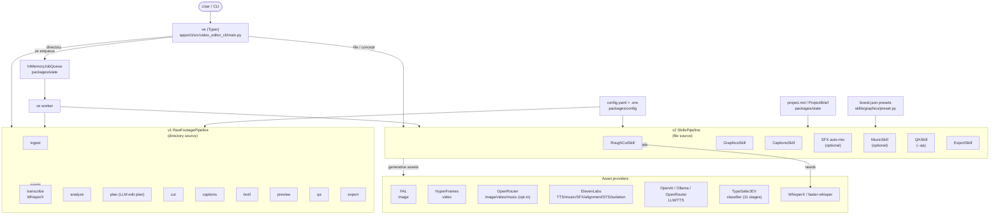
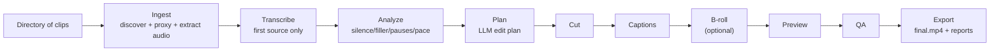
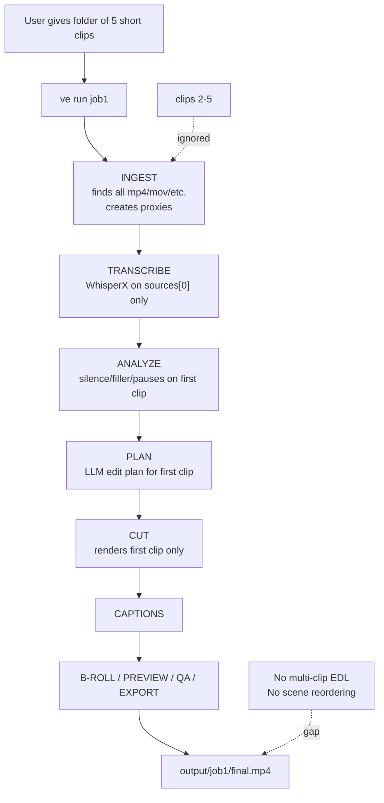
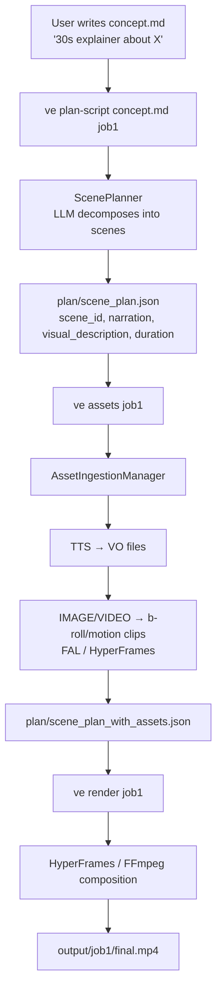
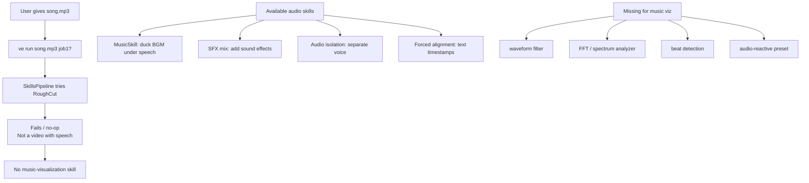
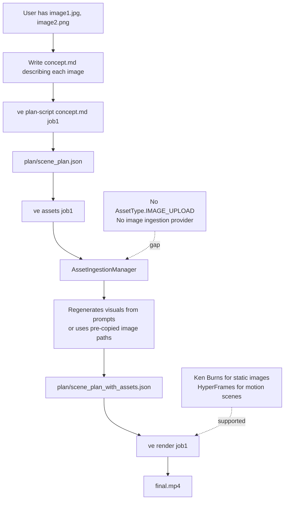
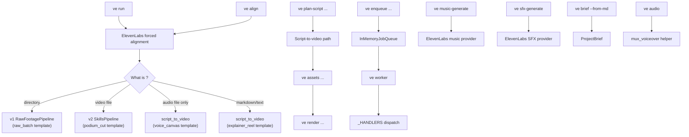

# Engine Architecture Explained

This document explains how the current video editor engine works end-to-end, what flows are triggered by different user inputs, and which use cases are supported, partially supported, or not yet implemented.

## 1. Overall engine architecture

Main pieces:

- **`apps/cli`** — Typer CLI `ve`. Entry point is `video_editor_cli.main:app` (`apps/cli/pyproject.toml:29`). Dispatches both synchronous commands and the async job-queue worker.
- **`apps/engine`** — Orchestrator modules for the legacy raw-footage pipeline, scene planner, b-roll generation, and analysis helpers.
- **`apps/transcribe`** — `faster-whisper` / WhisperX wrapper.
- **`packages/state`** — `JobContext`, `ArtifactStore`, `JobManifest`, `InMemoryJobQueue`, `ProjectBrief`.
- **`packages/ffmpeg`** — FFmpeg wrappers: cuts, captions, b-roll, voiceover mux, SFX mix, normalize, proxy, probe, regions.
- **`packages/llm`** — Model-agnostic LLM client/router with Ollama Cloud Pro defaults and cost/circuit-breaker guardrails.
- **`packages/asset_ingestion`** — Provider registry and managers for generative assets (TTS, image, video, music, SFX, alignment, isolation, speech-to-speech).
- **`packages/config`** — Unified `config.yaml` loader (`ProjectConfig`).
- **`engine` / `video_editor_core`** — Render cache, timeline/EDL, HyperFrames CLI wrapper.
- **`tools`** — Thin `ffmpeg` and WhisperX wrappers.
- **`skills/`** — v2 skill packages: `rough_cut`, `graphics`, `second_pass`, `captions`, `music`, `export`, `qa`.

Job model:

- Each job gets `work_root/<job_id>/` for intermediates and `output_root/<job_id>/` for deliverables (`JobContext.__init__`, `packages/state/src/video_editor_state/job.py:13-36`).
- A JSON `manifest.json` in the work dir records completed stages and operation logs (`JobManifest`, `packages/state/src/video_editor_state/manifest.py:25-69`).

Queue:

- Currently an **in-memory FIFO** with per-tenant round-robin, retries, and dead-letter support (`InMemoryJobQueue`, `packages/state/src/video_editor_state/queue.py:98-347`).
- Important limitation: `ve enqueue` and `ve worker` only share jobs if run in the **same process** (`apps/cli/src/video_editor_cli/main.py:1515-1558`, `2297-2423`). A persistent backend must be wired via config.

## 2. Template routing layer

Before any pipeline runs, a request passes through `TemplateRouter`
(`apps/engine/src/video_editor_engine/templates/router.py`). A template is a
named, supported recipe that maps user inputs to a pipeline kind, preset, aspect
ratio, and default providers.

Key points:

- Templates are **declarative** — they validate inputs and produce a
  `TemplateResult`; they do not render video themselves.
- `--template <name>` selects a template explicitly; otherwise the router infers
  it from the source path.
- Source → template inference:
  - directory → `raw_batch`
  - video file → `podium_cut`
  - audio file → `voice_canvas`
  - markdown/text file → `explainer_reel`
- Full list is documented in `docs/templates.md`.
- Detailed capabilities and examples per template are in `docs/Templates_capabilities.md`.
- Unsupported requests are listed in `docs/not_possible.md`.

The CLI can surface templates with `ve list-templates`, and the worker
dispatcher may use `TemplateResult` to choose between v1 raw, v2 skills, and
script-to-video flows.

## 3. Standard v2 pipeline (single source)

Triggered when you run `ve run <source_file> --job-id <job>`:

Key facts:

- `RoughCutSkill` is the gatekeeper: it creates the EDL (edit decision list) and the locked assembly.
- `GraphicsSkill` is where brand/preset overlays, lower-thirds, intros, etc. are applied.
- `CaptionsSkill` fails hard with `CaptionsError` if the transcript is empty.
- SFX auto-mix runs when `--sfx-provider` is passed or configured.
- Music runs when `--music-path` is provided, generated music exists, or a default music path is configured.
- QA is opt-in (`--qa`); the verification gate is opt-in (`--verify`) or auto-runs when `requirements.json` exists.

## 4. Standard v1 pipeline (directory of footage)

Triggered when you run `ve run <some_directory> <job>`:

**Critical limitation:** `transcribe`, `analyze`, `plan`, `cut`, and `captions` all operate on `sources[0]` only — **only the first video is used**. The rest are discovered but ignored.

## 5. Use-case flows

### Case A: "I have multiple short videos, edit them together"

What is triggered: `ve run <folder_with_videos> <job>` → goes into **v1 RawFootagePipeline**.

What it can do:

- Auto-transcribe the first clip.
- Cut silence/filler from the first clip.
- Add captions, b-roll, export.

What it **cannot** do:

- Use clips 2-5 in the edit.
- Concatenate multiple sources in order.
- Reorder scenes across clips.
- There is **no v2 multi-source path**.

Workaround today:

Manually concatenate clips with FFmpeg first, then run `ve run <concatenated.mp4> <job>`.

### Case B: "Create a video from just a text concept"

What is triggered: script-to-video path.

1. `ve plan-script <concept.md> <job>` → creates `plan/scene_plan.json`
2. `ve assets <job>` → resolves generative assets → `plan/scene_plan_with_assets.json`
3. `ve render <job>` → composes final MP4

What it can do:

- Turn a markdown script into timed scenes.
- Generate voiceover, background music, SFX, and visuals per scene.
- Render through HyperFrames (HTML) or the single-pass FFmpeg fallback.

What it **cannot** do:

- There is no single-string prompt command (`ve create "30s explainer about X"` does not exist).
- Scene durations are capped at ~300s per scene.
- Requires a `concept.md` file first.

### Case C: "Make a simple music visualization for this music file"

What is triggered: **Nothing currently.** There is no music-visualization skill or preset.

What it **cannot** do:

- No waveform visualization.
- No spectrum/FFT filter.
- No beat-synced cuts or animations.
- No dedicated `music-to-video` skill wired into the pipeline.

What exists that is close:

- `ve music-generate` creates AI background music.
- `MusicSkill` only mixes/ducks background music under speech.

### Case D: "I have multiple images, make an explanatory video"

What is triggered: Partially the **script-to-video path**, but images are **not ingested directly**.

What it can do:

- Static-image scenes via **Ken Burns effect**.
- Motion scenes via **HyperFrames** if configured.
- Narration, captions, music, SFX.

What it **cannot** do:

- Upload `image1.jpg` directly as an asset.
- `AssetType` enum has no direct image-ingestion type.
- Images must be described and regenerated, or manually copied into the work tree.

Workaround today:

Describe each image in `concept.md`, let `ve assets` regenerate matching visuals, or copy images into the work tree and reference them manually.

## 6. Command → path decision tree

## 7. Capability matrix

| Use case | Supported? | Path | Limitation |
|---|---|---|---|
| Single talking-head video | ✅ Yes | v2 SkillsPipeline | Full pipeline works |
| Directory of raw clips | ⚠️ Partial | v1 RawFootagePipeline | Only first clip used |
| Text concept → video | ✅ Yes | `plan-script → assets → render` | Needs markdown file |
| Music visualization | ❌ No | — | No skill/preset |
| Images → explainer | ⚠️ Partial | Script-to-video | No direct image ingestion |
| Add captions | ✅ Yes | CaptionsSkill | Needs non-empty transcript |
| Add background music | ✅ Yes | MusicSkill | Ducks under speech |
| Add SFX | ✅ Yes | SFX auto-mix | Opt-in |
| Transcribe + align | ✅ Yes | WhisperX / ElevenLabs align | — |
| Persistent queued jobs | ⚠️ Partial | In-memory queue | Same-process only |

## 8. How config, brief, and brand fit in

### `config.yaml`

- Loaded by `ProjectConfig.load()` (`packages/config/src/video_editor_config/__init__.py:118-258`).
- Sections: `llm`, `transcription`, `audio`, `render`, `paths`, `assets`.
- `llm` feeds `LLMConfig` and `ModelRouter` (`packages/llm/src/video_editor_llm/config.py:88-121`, `router.py:88-97`).
- `assets` feeds `AssetProviderConfig` for generative provider API keys/models/timeouts (`packages/asset_ingestion/src/video_editor_asset_ingestion/config.py:125-178`).
- `render` drives codec, resolution, bitrate, fps, CRF, cache dir, output template.
- `paths` resolves repo-relative directories (presets, projects, outputs, assets, music).

### `ProjectBrief`

- Parsed from `<work_dir>/project.md` with YAML front-matter + H1/body fallback (`packages/state/src/video_editor_state/project_brief.py:43-309`).
- Carried on `JobContext` or auto-discovered via `load_brief_from_workdir()`; consumed by `ExportSkill` for report metadata (`skills/export/src/export/export.py:100-128`).
- Installed by `ve brief --from-md <path>` (`apps/cli/src/video_editor_cli/main.py:2436-2481`) and its worker handler `_handle_brief` (`apps/cli/src/video_editor_cli/main.py:2216-2259`).

### Brand docs

- Global brand at `<presets_dir>/brand.json`; per-project/per-tenant overrides in `<presets_dir>/brands/<job_id>.json` and `<tenant_id>.json` (`skills/graphics/src/graphics/preset.py:32-87`).
- Brand is merged into presets (`load_preset(..., brand=brand)`) and can derive `CaptionStyle` and `MusicStyle` (`skills/graphics/src/graphics/preset.py:89-106`, `skills/captions/src/captions/captions.py:31-42`, `skills/music/src/music/music.py:29-57`).

## 9. Key files to trace manually

- CLI dispatch: `apps/cli/src/video_editor_cli/main.py:1008-1097`
- v2 pipeline: `apps/cli/src/video_editor_cli/pipeline.py:288-457`
- v1 pipeline: `apps/engine/src/video_editor_engine/pipeline/raw_footage.py:360-377`
- Worker + handlers: `apps/cli/src/video_editor_cli/main.py:2262-2423`
- Scene planner: `apps/engine/src/video_editor_engine/planner/scene_planner.py:115-184`
- Asset manager: `packages/asset_ingestion/src/video_editor_asset_ingestion/manager.py:129-454`
- RoughCut: `skills/rough_cut/src/rough_cut/rough_cut.py:108-456`
- Graphics: `skills/graphics/src/graphics/graphics.py:31-259`
- Captions: `skills/captions/src/captions/captions.py:22-228`
- Music: `skills/music/src/music/music.py:26-181`

---

**Bottom line:** the engine is production-ready for **single speech-driven videos** and **script-to-video generation**, but it has three clear gaps: **multi-clip assembly**, **music visualization**, and **direct image ingestion**.
