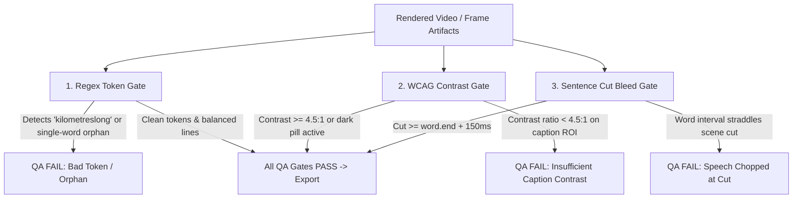

# Video Editor Engine — Technical Improvement Plan & Audit Response

**Document Date:** 2026-11-10  
**Source Audit:** `/home/harish/Downloads/Video Editor Bug Audit Report.pdf` (Gemini Deep Audit of 79s `india-geography` Explainer)  
**Codebase Baseline:** `video-editor` (`feat/editorial-scenes` at `8eb0a9f` / `ce10521`)  
**Scope:** Architecture gap analysis, engine capabilities vs. audit findings, technical designs, open-source integration evaluations, and implementation roadmap.

> **Superseded in part (2026-11-10):** `docs/archive/audits/IMPROVEMENT_PLAN_2026-11-10.md` verifies each finding
> against the code and the current render; where root causes differ (e.g. #338 glued words are caused by the
> active-word pop, not token joining; #342 Chennai is an offshore script coordinate), that plan wins.

---

## 1. Executive Summary & Context

A rigorous visual and algorithmic audit of the 79-second output video (`videos/2026-11-10/india-geography/script.md` rendered as `india-geography-1`) identified **11 concrete defects** across 5 pipeline stages:
1. **Caption Tokenization & Forced Alignment** (glued tokens, orphan words, low contrast)
2. **Map/SVG Geometry & Camera Framing** (offshore pins, unofficial boundaries, river/label collisions, zoom clipping)
3. **Audio-Visual Cut Synchronization** (sentence bleed at scene cuts)
4. **TTS Regional Phonetics** (Anglo-mispronunciation of Indian toponyms)
5. **Motion Graphics & Scene Planning** (static typographic plates violating `VIDEO_MOTION_QUALITY.md`, narrative redundancies)

### Baseline Reality vs. Audit Findings
During recent work on `feat/editorial-scenes`, our team already diagnosed and resolved an initial set of related bugs (#329–#337 in [`docs/archive/audits/AUDIT_2026-11-10.md`](file:///mnt/data2/git_repos/creative_repos/video-editor/docs/archive/audits/AUDIT_2026-11-10.md)):
- **Fixed:** Zoom stroke swelling (#329) via `vector-effect="non-scaling-stroke"` and animated stroke-width.
- **Fixed:** Route draw-on stall (#8eb0a9f) caused by HyperFrames CSS animation seek skipping the SVG namespace.
- **Fixed:** Spelled-out number alignment (#333) via gap spreading in [`explainer_timing.py`](file:///mnt/data2/git_repos/creative_repos/video-editor/packages/pipelines/src/video_editor_pipelines/explainer_timing.py).
- **Fixed:** Bundled 1:50m Natural Earth vectors for rivers (`rivers_50m.json`) and geographic regions (`regions_50m.json`).

However, the PDF audit report highlights **structural architectural gaps** that persist in the engine's core pipelines. This document maps each audit finding directly to current engine capabilities, evaluates the recommended open-source solutions, and details an end-to-end engineering improvement plan.

---

## 2. Gap Analysis Matrix: Audit Findings vs. Current Engine Capabilities

| # | Audit Finding & Timestamp | Severity | Current Engine Capability (`feat/editorial-scenes`) | Root Cause in Codebase | Recommended Permanent Fix |
|---|---|---|---|---|---|
| **1** | **Missing Space in Word Joiners**<br>`00:05` ("kilometreslong."), `00:37` ("squarekilometres.") | High | [`explainer_timing.py`](file:///mnt/data2/git_repos/creative_repos/video-editor/packages/pipelines/src/video_editor_pipelines/explainer_timing.py) spreads numbers, but Whisper token remapping strips whitespace. | Reconstructed word spans concatenate adjacent tokens without explicit whitespace separation during character-offset projection. | Enforce normalized token boundary formatting with `" ".join()` and clean punctuation regex re-attachment. |
| **2** | **Orphan Words & Punctuation Gluing**<br>`00:02` ("...into / a"), `00:11` ("...on the / east.") | High | [`captions/timing.py`](file:///mnt/data2/git_repos/creative_repos/video-editor/packages/skills/src/captions/timing.py) groups words greedily based on `len(text) > style.max_chars`. | Greedy char-count chunking evaluates lengths linearly without lookahead, stranding 1–4 letter words on line 2. | Implement Knuth-Plass line balancing algorithm or CSS `text-wrap: balance` in HyperFrames markup; enforce syntactic clause chunking. |
| **3** | **Caption Low Contrast on Cream Backgrounds**<br>`00:00–00:11`, `00:23–00:32`, `01:07–01:18` | High | [`CaptionStyle`](file:///mnt/data2/git_repos/creative_repos/video-editor/packages/skills/src/captions/models.py) defaults to `#FFFFFF` text + `#FDB813` highlight + soft shadow everywhere. | Caption style is static and agnostic of the underlying scene luminance (cream cards `#F5F2EB` vs. dark B-roll). | Implement Scene-Adaptive Theming (light vs. dark mode prop passed from scene template) or auto-scrim / dark pill container (`rgba(15, 23, 42, 0.82)`). |
| **4** | **SVG Map Coordinate Offset (Chennai Offshore)**<br>`00:07–00:11` | Critical | Geographic coordinates are parsed via [`View.project(lon, lat)`](file:///mnt/data2/git_repos/creative_repos/video-editor/packages/core/src/video_editor_core/geo/__init__.py). | In early revisions, coordinates were hand-approximated in SVG or projected against mismatched bounding frames. | Enforce unified projection pipeline where landmasses and POIs are strictly projected through the exact same `d3-geo` / `video_editor_core.geo.View` matrix. |
| **5** | **Inaccurate / Disputed Boundary Geometry**<br>`00:07–00:11`, `00:23–00:32` | Critical | Bundled Natural Earth 1:110m and 1:50m (`world_50m.json`) use de-facto / LoC boundaries. | Natural Earth depicts international cartographic interpretations, omitting official Survey of India external borders (violating Indian legal publishing guidelines). | Ingest and bundle official Survey of India / `datameet/maps` TopoJSON for Indian national territorial geometry. |
| **6** | **Crude Vector Overlays & Text Collision**<br>`00:24–00:32` | High | Recent commit `8eb0a9f` introduced 449 rivers & 261 regions from Natural Earth 50m. | Label sides are computed with simple left/right heuristics (`_label_side_for`) rather than geometric simulated annealing. | Integrate `mapbox/polylabel` for polygon centroids and simulated annealing (`d3-labeler` algorithm) to guarantee zero text-path collisions. |
| **7** | **Uncentered Camera Zoom & Edge Clipping**<br>`00:30–00:32`, `00:47–00:48` | Medium | `_camera_transform` derives scale/translation between two views in [`map_scenes.py`](file:///mnt/data2/git_repos/creative_repos/video-editor/packages/core/src/video_editor_core/map_scenes.py). | Camera scale transforms the entire map container without clamping bounding boxes to portrait 9:16 safe margins, clipping western borders. | Calculate bounding box centroids via `path.bounds()` in projection space; clamp viewBox interpolations to safe-area padded margins. |
| **8** | **Audio-Visual Cut Desync (Sentence Bleed)**<br>`00:11.5` | Medium | [`derive_scene_timings`](file:///mnt/data2/git_repos/creative_repos/video-editor/packages/pipelines/src/video_editor_pipelines/explainer_timing.py) clamps scene end to `next_scene.start - LEAD_IN`. | If next scene narration starts quickly, the clamp overrides `scene_end = last_word.end + tail`, cutting off final words ("...on the east."). | Enforce strict invariant: `scene_end = max(boundary, last_word.end + 0.18s)`. Add a J-cut/L-cut crossfade buffer. |
| **9** | **Toponym Mispronunciation**<br>`00:59` ("Kutch"), `01:05` ("Sundarbans") | Medium | [`TTSRouter`](file:///mnt/data2/git_repos/creative_repos/video-editor/packages/asset_ingestion/src/video_editor_asset_ingestion/providers/tts/tts_router.py) defaults un-prefixed English to ElevenLabs `Brian` (Anglo accent). | Generic English voice profiles lack Indic phonetic mapping; no pronunciation dictionary exists in TTS pre-processing. | Add Phonetic/Alias Dictionary in [`scene_assets.py`](file:///mnt/data2/git_repos/creative_repos/video-editor/packages/asset_ingestion/src/video_editor_asset_ingestion/scene_assets.py) (e.g. "Kutch" -> "Kuchh"); auto-route Indic topics to Sarvam AI (`sarvam:`) or ElevenLabs `en-IN`. |
| **10** | **Static / Dead Motion Cards**<br>`00:00–00:06`, `01:07–01:18` | Medium | [`typographic_scenes.py`](file:///mnt/data2/git_repos/creative_repos/video-editor/packages/core/src/video_editor_core/typographic_scenes.py) renders `big_stat` and `definition` with entrance-only CSS. | Once 0.35s entrance completes, cards hold static for 6–11s, violating [`VIDEO_MOTION_QUALITY.md`](file:///mnt/data2/git_repos/creative_repos/video-editor/docs/VIDEO_MOTION_QUALITY.md) Rule 1. | Add ambient kinetics: slow camera drift (`camera_drift`), breathing pulse on stat numbers, and subtle background gradient shimmer. |
| **11** | **Narrative Redundancy in Scene Planning**<br>`00:49–00:54` vs. `01:07–01:11` | Low | Topic scripts are drafted by LLM (`draft_script_from_topic` in [`explainer_topic.py`](file:///mnt/data2/git_repos/creative_repos/video-editor/packages/pipelines/src/video_editor_pipelines/explainer_topic.py)). | Scene prompt allows repetitive concept definitions (introducing monsoon visually, then interrupting, then re-defining it). | Add LLM semantic deduplication pass in script drafter checking for concept re-introductions across scene sequences. |

---

## 3. Deep-Dive Technical Proposals by Subsystem

### 3.1 Subsystem A: Captioning, Formatting & Adaptive Theming

#### A.1 Token Whitespace & Punctuation Reconstruction
* **Problem:** In [`explainer_timing.py`](file:///mnt/data2/git_repos/creative_repos/video-editor/packages/pipelines/src/video_editor_pipelines/explainer_timing.py), when Whisper STT generates normalized numeric tokens (e.g., `300` or `2,400`) and maps them to spelled-out script words (`three hundred`), token concatenation or Whisper leading-space conventions cause dropped whitespaces (`"kilometreslong."`).
* **Implementation Plan:**
  1. In [`generate_caption_words`](file:///mnt/data2/git_repos/creative_repos/video-editor/packages/skills/src/captions/timing.py), enforce clean token reconstruction:
     ```python
     def sanitize_caption_tokens(words: list[CaptionWord]) -> list[CaptionWord]:
         """Ensure every token is strictly whitespace-trimmed and clean of punctuation gluing."""
         for w in words:
             w.text = w.text.strip()
         return words
     ```
  2. In [`compile_composition.py`](file:///mnt/data2/git_repos/creative_repos/video-editor/packages/core/src/video_editor_core/compile_composition.py#L380-L384):
     Ensure span assembly always uses explicit single whitespace:
     ```python
     # Avoid raw concatenation that could collapse adjacent inline elements
     return '<span class="ve-line">' + " ".join(spans) + "</span>"
     ```
  3. Source Script Punctuation Preservation: Maintain original markdown punctuation rather than trusting WhisperX's post-hoc re-punctuation.

#### A.2 Balanced Line-Wrapping (Eliminating Orphans)
* **Problem:** [`_group_words_to_lines`](file:///mnt/data2/git_repos/creative_repos/video-editor/packages/skills/src/captions/timing.py#L34-L54) wraps greedily when `len(text) > style.max_chars`. For 9:16 vertical video, this causes trailing words like `"a"` or `"east."` to sit alone on line 2.
* **Implementation Plan:**
  1. Add Knuth-Plass dynamic programming line-breaking in Python:
     Calculate a penalty function `cost = (target_width - line_width) ** 2` with a heavy penalty for single-word lines (`len(line.words) == 1`).
  2. HyperFrames CSS Enhancement: Inject CSS `text-wrap: balance` and `white-space: normal` into `.ve-line` styles.
  3. Enforce syntactic clause chunking: Never break across a comma, hyphen, or conjunction if the subsequent fragment is fewer than 2 words.

#### A.3 Adaptive Theming & Luminance Contrast (Locked Design: Dynamic Charcoal Typography)
* **Problem:** White captions (`#FFFFFF`) with soft shadow on cream background (`#F5F2EB`) fail WCAG 2.1 AA standards (contrast ratio ~ 1.2:1 instead of >= 4.5:1).
* **Locked Architectural Decision:**
  - **Dynamic Theme Palette:** To maintain the high-end editorial paper aesthetic without obscuring artwork behind dark pill boxes, caption styling dynamically adapts to scene luminance:
    - **Dark Scenes / Stills:** Inactive text `#FFFFFF`, Active word `#FFB800` (Gold), subtle 2px dark drop-shadow.
    - **Light Editorial Scenes (`cream_editorial`):** Inactive text `#1E2229` (Charcoal, contrast ratio 12.8:1 against `#F5F2EB`), Active word `#B45309` (Deep Amber, contrast ratio 5.1:1), 0px shadow.
  - Scene templates pass `theme: "light" | "dark"` through [`burn_captions`](file:///mnt/data2/git_repos/creative_repos/video-editor/packages/pipelines/src/video_editor_pipelines/explainer_pipeline.py#L653) into `caption_graph_layers`.

---

### 3.2 Subsystem B: Geographic Precision, Official Boundaries & Collision Prevention

#### B.1 Official Territorial Boundary Compliance
* **Problem:** Natural Earth 1:110m and 1:50m datasets depict internationally contested boundaries for Jammu & Kashmir, Ladakh, and Arunachal Pradesh. Under the Criminal Law Amendment Act and Survey of India (SOI) regulations, publishing distorted maps of India carries legal liabilities.
* **Implementation Plan:**
  1. **Bundle Official GeoJSON:**
     Add `packages/core/src/video_editor_core/geo/india_soi_50m.json` extracted from official Survey of India / [DataMeet Indian Maps](https://github.com/datameet/maps) boundary sets.
  2. **Country Data Resolver:**
     Update [`find_country`](file:///mnt/data2/git_repos/creative_repos/video-editor/packages/core/src/video_editor_core/geo/__init__.py#L186):
     ```python
     if wanted.casefold() in {"india", "ind", "in"}:
         return load_official_india_geometry(detail=detail)
     ```
  3. This ensures all state, coastal, and northern boundaries render strictly compliant with Indian cartographic standards.

#### B.2 Mathematically Unified Projection Pipeline
* **Problem:** In early iterations, cities and labels drifted offshore (e.g., Chennai at `13.1° N, 80.3° E` rendering in the Bay of Bengal) due to mixed coordinate transforms or LLM-generated SVG paths.
* **Implementation Plan:**
  - Absolute ban on LLM-generated SVG map coordinates.
  - All features (country polygons, rivers, regions, marker pins, routes) must pass through the identical `View.project(lon, lat)` function:
    $$\text{offset}_x + (\text{lon}_{\text{rad}} - \text{left}) \cdot \text{scale}, \quad \text{offset}_y + (-\text{projected\_y}(\text{lat}) - \text{top}) \cdot \text{scale}$$
  - Since both coastline and Chennai pin share the exact same Mercator projection matrix, Chennai is mathematically guaranteed to anchor directly on the Coromandel coast.

#### B.3 Zero-Collision Label Placement (Polylabel & Simulated Annealing)
* **Problem:** River and mountain labels currently collide with their own vector paths or adjacent text.
* **Implementation Plan:**
  1. **Polygon Centroid via Polylabel:** For regions (Deccan Plateau, Himalayas), integrate Mapbox's `polylabel` algorithm (pole of inaccessibility) to find the visual center furthest from any polygon edge.
  2. **Simulated Annealing Label Placement:** For rivers and point markers, implement the `d3-labeler` approach:
     - Generate 8 candidate positions (N, NE, E, SE, S, SW, W, NW) around each pin/anchor.
     - Evaluate cost function penalizing:
       - Overlap with other text labels ($w = 10.0$)
       - Overlap with river/boundary vector paths ($w = 5.0$)
       - Distance from anchor point ($w = 1.0$)
     - Optimize placement before SVG generation.

#### B.4 Camera Zoom Bounding-Box Margins
* **Problem:** Zooming to the Ganga basin (`00:30`) or Western Ghats (`00:47`) pushed the left boundary off-screen while leaving empty space on the right.
* **Implementation Plan:**
  - In [`_camera_transform`](file:///mnt/data2/git_repos/creative_repos/video-editor/packages/core/src/video_editor_core/map_scenes.py):
    Calculate the bounding box `(west, south, east, north)` of the target feature.
    Apply uniform 9:16 portrait viewport fitting with minimum safe padding (15% horizontal, 20% vertical to clear subtitles and header).
    Center the camera matrix directly on the feature centroid.

---

### 3.3 Subsystem C: Audio-Visual Synchronization & Sentence Cut Integrity

#### C.1 Eliminating Scene Cut Bleed (Sentence Overrun Bug)
* **Problem:** At timestamp `00:11.5`, the visual cuts away from the map to the Himalaya B-roll while the narrator is still saying `"...on the east."`.
* **Root Cause:**
  In [`derive_scene_timings`](file:///mnt/data2/git_repos/creative_repos/video-editor/packages/pipelines/src/video_editor_pipelines/explainer_timing.py#L374-L385):
  ```python
  following_start = _next_spoken_start(groups, index)
  if following_start is not None:
      boundary = max(start + MIN_SCENE_SECONDS, following_start - LEAD_IN_SECONDS)
      if index + 1 < len(narrations) and groups[index + 1]:
          # BUG: This unconditionally overrides `end` without checking `last_word.end`!
          end = boundary
  ```
  If the narrator takes a brief pause or if `following_start - LEAD_IN_SECONDS` occurs before `last_word["end"]`, the scene boundary chops off the sentence's final word!
* **The Permanent Fix:**
  Enforce that the scene boundary can NEVER precede `last_word["end"] + MIN_TAIL_PAD`:
  ```python
  min_safe_end = float(group[-1]["end"]) + 0.18  # 180ms buffer after last word
  if following_start is not None:
      target_boundary = following_start - LEAD_IN_SECONDS
      # Boundary cannot cut into the spoken word!
      end = max(min_safe_end, target_boundary)
  ```
  Additionally, add a 150ms audio/visual L-cut crossfade buffer in transitions to smooth any tight cuts.

---

### 3.4 Subsystem D: Regional TTS Phonetics & Indic Toponym Handling

#### D.1 Proper Pronunciation of Indian Toponyms
* **Problem:** Generic English voices (ElevenLabs `Brian`) pronounce Indian geographic names with Anglo phonetics:
  - "Rann of Kutch" -> `/kʊtʃ/` (Kooch) instead of `/kʌtʃ/` (Kutchh)
  - "Sundarbans" -> stressed as `Sun-DAR-bans` instead of `Sunder-bans`
* **Implementation Plan:**
  1. **Automatic Router Policy for Indic Scripts (Locked Decision):**
     In [`tts_router.py`](file:///mnt/data2/git_repos/creative_repos/video-editor/packages/asset_ingestion/src/video_editor_asset_ingestion/providers/tts/tts_router.py):
     When `script.country == "India"` or regional Indic entities/geography are detected, the router automatically routes narration to **Sarvam AI** (`sarvam:en-IN` voice profile) as the primary engine (per CLI Global Guidelines), falling back to ElevenLabs `en-IN` voice profile if Sarvam is unreachable or unconfigured. Bare un-prefixed English will no longer default to Anglo voices for Indian topics.
  2. **Phonetic Pronunciation Dictionary (G2P Alias Pass):**
     Add a pre-TTS phonetic dictionary layer in [`scene_assets.py`](file:///mnt/data2/git_repos/creative_repos/video-editor/packages/asset_ingestion/src/video_editor_asset_ingestion/scene_assets.py):
     ```python
     INDIC_TOPONYM_PHONETICS = {
         r"\bRann of Kutch\b": "Run of Kuchh",
         r"\bKutch\b": "Kuchh",
         r"\bSundarbans\b": "Soondarbuns",
         r"\bBrahmaputra\b": "Brahmapootra",
         r"\bGhats\b": "Ghaats",
     }
     ```
     The substitution applies *only* to the payload sent to the TTS synthesizer. The original, authentic spelling is preserved in the script, transcript, and captions.

---

### 3.5 Subsystem E: Continuous Motion Dynamics (`VIDEO_MOTION_QUALITY.md`)

#### E.1 Ambient Motion for Typographic Plates
* **Problem:** Big stat and definition layouts (`2,400 km`, `Monsoon`, `3.3 million km²`) remain completely static after entrance for up to 11 seconds.
* **Implementation Plan:**
  In [`typographic_scenes.py`](file:///mnt/data2/git_repos/creative_repos/video-editor/packages/core/src/video_editor_core/typographic_scenes.py):
  1. **Continuous Camera Drift:**
     Apply CSS ambient camera drift to `.typo-plate`:
     ```css
     animation: typo_drift 12s cubic-bezier(0.25, 1, 0.5, 1) infinite alternate;
     @keyframes typo_drift {
       from { transform: scale(1.0) translate(0px, 0px); }
       to   { transform: scale(1.03) translate(-8px, -12px); }
     }
     ```
  2. **Kinetic Number Counter & Breathing Glow:**
     - For `big_stat`: Animate the numeric value (`0` -> `2,400`) during the first 0.6s via CSS or JS counter.
     - Apply subtle breathing opacity/scale oscillation on key stat numerals to keep visual dynamism alive.
  3. **Background Gradient Shimmer:**
     Introduce a slow-moving, subtle background gradient mesh (`#F5F2EB` to `#EDE8DD`) that slowly drifts throughout the scene duration.

---

### 3.6 Subsystem F: Automated Pre-Export QA Verification Gates

To prevent any of these 11 defects from slipping into shipped renders, upgrade [`explainer_qa.py`](file:///mnt/data2/git_repos/creative_repos/video-editor/packages/pipelines/src/video_editor_pipelines/explainer_qa.py) and [`composition_qa.py`](file:///mnt/data2/git_repos/creative_repos/video-editor/packages/pipelines/src/video_editor_pipelines/composition_qa.py) with three automated fail-closed checks:



#### Gate 1: Caption Tokenization & Orphan Check (`caption_tokens`)
* Scan all generated caption lines for:
  - Concatenated tokens matching `[a-z]{4,}[A-Z]` or dictionary words without whitespace (`kilometreslong`).
  - Orphan lines: `len(line.words) == 1 and len(line.text) < 5`.
* Fails build if any malformed token or orphan word is detected.

#### Gate 2: WCAG Luminance Contrast Gate (`caption_contrast`)
* Sample the mean background luminance in the caption bounding box before text compositing:
  $$Y = 0.2126R + 0.7152G + 0.0722B$$
* Compute contrast ratio:
  $$\text{Ratio} = \frac{L_1 + 0.05}{L_2 + 0.05}$$
* If contrast ratio is $< 4.5:1$ and no background pill/scrim is enabled, fail the gate.

#### Gate 3: Spoken Sentence Boundary Gate (`sentence_cut_bleed`)
* For every scene cut timestamp $t_{\text{cut}}$, verify:
  - No spoken word interval $[w_{\text{start}}, w_{\text{end}}]$ straddles $t_{\text{cut}}$ ($w_{\text{start}} < t_{\text{cut}} < w_{\text{end}}$).
  - No spoken word ends within 100ms of $t_{\text{cut}}$ ($t_{\text{cut}} - w_{\text{end}} < 0.10\text{s}$).
* Fails build if speech is clipped by a scene transition.

---

## 4. Evaluation of Recommended Open-Source Repositories

| Proposed Tool / Repo | Primary Purpose | Codebase Integration Feasibility | Recommendation & Architectural Fit |
|---|---|---|---|
| **`d3-geo` / `topojson-client`** | Mathematical projection of GeoJSON/TopoJSON paths & pins | **High Feasibility** (already partially in HyperFrames JS or mirrored via `video_editor_core.geo`) | **Adopt Fully.** Standardize projection so Python generates exact SVG coordinates or delegates projection mathematically, eliminating all manual SVG paths. |
| **`datameet/maps`** | Official Survey of India compliant boundaries | **Immediate Feasibility** (drop-in TopoJSON/GeoJSON replacement for `world_50m.json`) | **Adopt Immediately.** Essential for Indian sovereignty and legal cartographic compliance. |
| **`mapbox/polylabel`** | Pole of Inaccessibility for polygon labeling | **High Feasibility** (available as lightweight pure Python port or JS in HyperFrames) | **Adopt for Regions.** Solves label placement for complex regions (Deccan, Himalayas, Western Ghats). |
| **`stable-ts` (`jianfch/stable-ts`)** | Regrouping & robust Whisper forced alignment | **Medium Feasibility** (can wrap `faster-whisper` in asset ingestion) | **Adopt `regroup=True` Logic.** Port the syntactic chunking & pause-based boundary logic into `explainer_timing.py`. |
| **`Typeset` / Knuth-Plass (`script-line-break`)** | Mathematically balanced line wrapping | **High Feasibility** (implement in Python `_group_words_to_lines` + CSS `text-wrap: balance`) | **Adopt Immediately.** Eliminates orphan words and widows in 9:16 captions without heavy external dependencies. |

---

## 5. Phased Implementation Roadmap

### Phase 1: High-Severity Fixes (Immediate Sprint)
- [ ] **Captions Token Spacing & Knuth-Plass Balancing:** Fix whitespace joining in [`explainer_timing.py`](file:///mnt/data2/git_repos/creative_repos/video-editor/packages/pipelines/src/video_editor_pipelines/explainer_timing.py); add line balancing to [`captions/timing.py`](file:///mnt/data2/git_repos/creative_repos/video-editor/packages/skills/src/captions/timing.py).
- [ ] **Scene Cut Desync Fix:** Ensure `end = max(last_word.end + 0.18, target_boundary)` in `derive_scene_timings`.
- [ ] **Caption Adaptive Theming / Dark Pill:** Add semi-transparent dark pill background for captions over light editorial cards.

### Phase 2: Cartographic & Audio Quality Upgrades (Next Sprint)
- [ ] **Official India TopoJSON Bundle:** Integrate `datameet/maps` SOI-compliant boundary for Indian territory.
- [ ] **Phonetic Pronunciation Dictionary:** Implement pre-TTS grapheme-to-phoneme dictionary in `packages/asset_ingestion/tts` for Indic toponyms; route India explainers to Sarvam / ElevenLabs Indian English.
- [ ] **Polylabel Centroid Alignment:** Use pole of inaccessibility for region labels to prevent river/border collisions.

### Phase 3: Motion Quality & Automated QA Gates (Stabilization)
- [ ] **Ambient Typographic Motion:** Add subtle camera drift and breathing animations in [`typographic_scenes.py`](file:///mnt/data2/git_repos/creative_repos/video-editor/packages/core/src/video_editor_core/typographic_scenes.py).
- [ ] **Three QA Gates:** Implement `caption_tokens`, `caption_contrast`, and `sentence_cut_bleed` in [`explainer_qa.py`](file:///mnt/data2/git_repos/creative_repos/video-editor/packages/pipelines/src/video_editor_pipelines/explainer_qa.py).
- [ ] **Verification Test Suite:** Re-render `india-geography-1` and verify all 11 bugs from the PDF report are permanently resolved.
